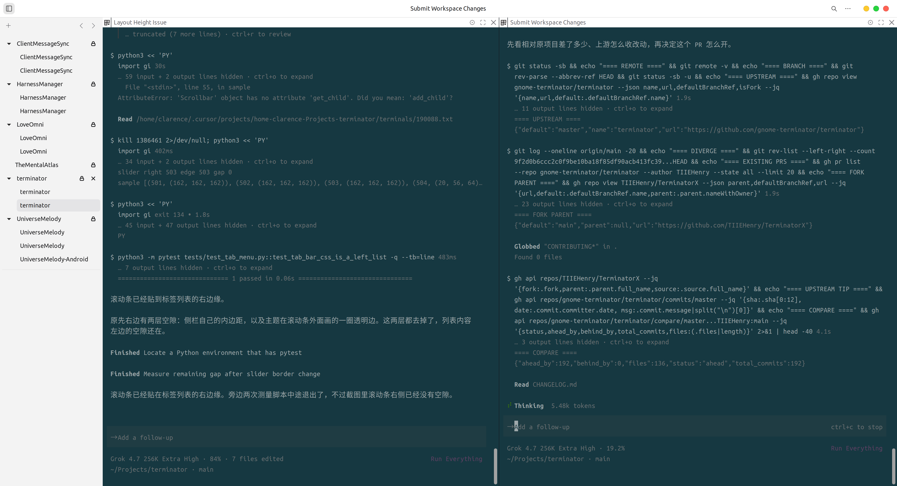
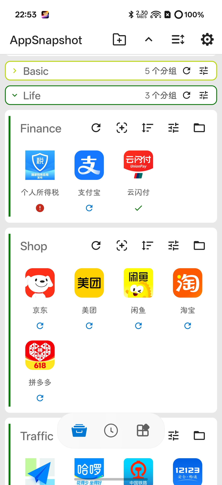
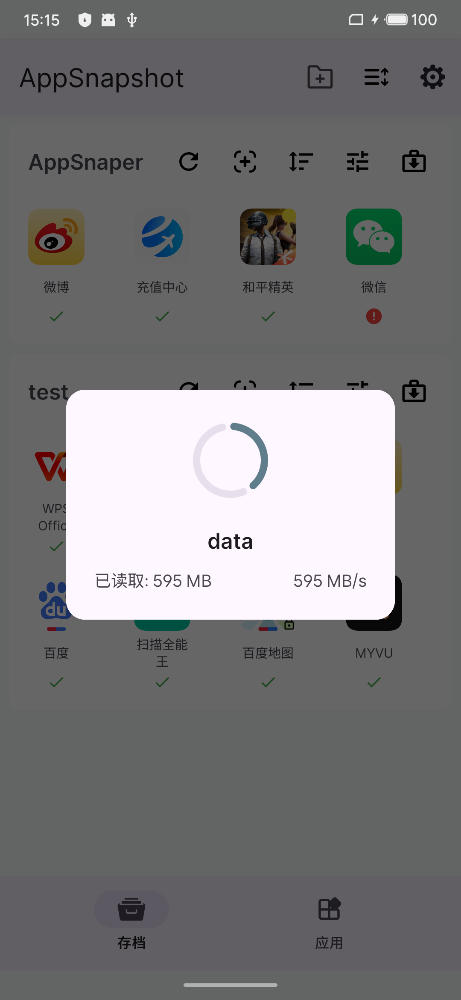
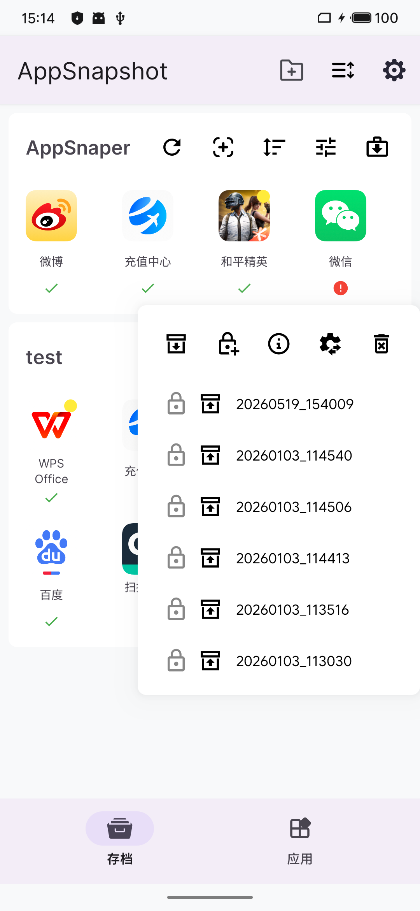
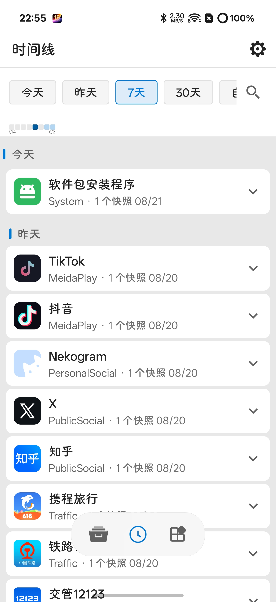
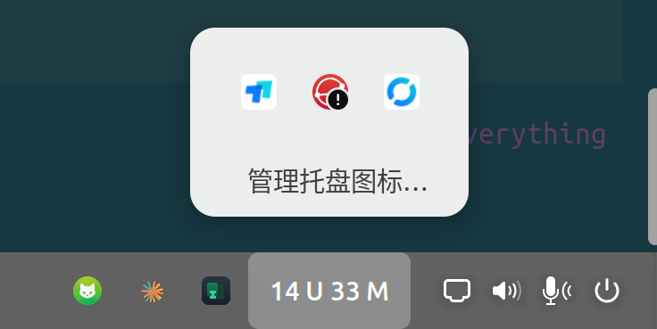
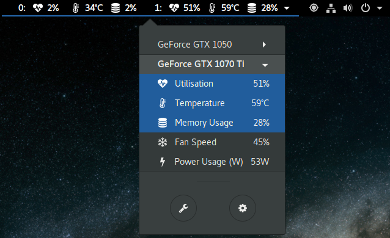

# 公开项目

## TerminatorX

### [TerminatorX](https://github.com/TIIEHenry/TerminatorX)

一个窗口里放多个终端。标签和窗格在左侧，拖动可以重排、嵌到别的标签下，或把窗格拉成自己的标签。一个窗格可以盖住其余窗格，再退回来。终端用的是 GNOME Terminal 那套 VTE。窗口只有白色标题栏；窗格之间是一条 1px 的线，分割之后才有窗格标题栏。

命令名是 `terminator`。

## Android

### [AppSnapshoter](https://github.com/TIIEHenry/AppSnapshoter)

在 Root 下把一个应用的安装包和数据打成快照，用来备份和恢复。每个应用可以留多份，也可以按时间线翻。

### [ClashMetaForAndroid](https://github.com/TIIEHenry/ClashMetaForAndroid)

Clash Meta 的 Android 客户端。哪些应用走代理，可以存成几份策略，用的时候换一份。

### [CrashCenter](https://github.com/TIIEHenry/CrashCenter)

拦住应用里没人接住的 Java 异常，让它不要直接闪退，并留下崩溃日志。

### [HyperOSRuntime](https://github.com/TIIEHenry/HyperOSRuntime)

在别的手机系统上跑 HyperOS 的天气、相册这些系统应用。系统版本和芯片平台要和原来的机型一致。

### [Android-Interface-IPC](https://github.com/TIIEHenry/Android-Interface-IPC)

跨进程调用写成普通的 Java 接口，不用 AIDL 文件。

## 编码代理

### [AgenticLoopDev](https://github.com/TIIEHenry/AgenticLoopDev)

编码代理按仓库里写好的任务做。每个任务占一个工作区，合回去时两边没提交的修改都留着。

## 桌面

这四项在同一条面板上一起用。

### [Gnome-AppIndicatorChip](https://github.com/TIIEHenry/Gnome-AppIndicatorChip)

托盘收成一块读数。面板上是 `14 U 33 M`，钉住的图标留在旁边，其余收进点开的格子里，底下是「管理托盘图标...」。读数宽度固定，数字变了，旁边的图标不动。

### [Gnome-TopBarOrganizer](https://github.com/TIIEHenry/Gnome-TopBarOrganizer)

托盘图标按应用记位置。应用重启后还是原来那一条，设置里不会因为进程号换了就多出一条。

### [Gnome-NetSpeed](https://github.com/TIIEHenry/Gnome-NetSpeed)

网速放在固定宽度里。位数和单位变了，面板上旁边的图标不动。

### [gnome-nvidia-extension](https://github.com/TIIEHenry/gnome-nvidia-extension)

面板上的 NVIDIA 读数。要看哪些项，在菜单里勾。

